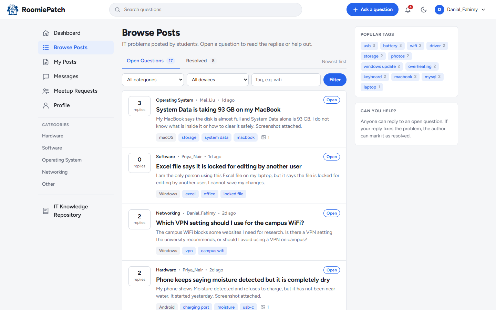
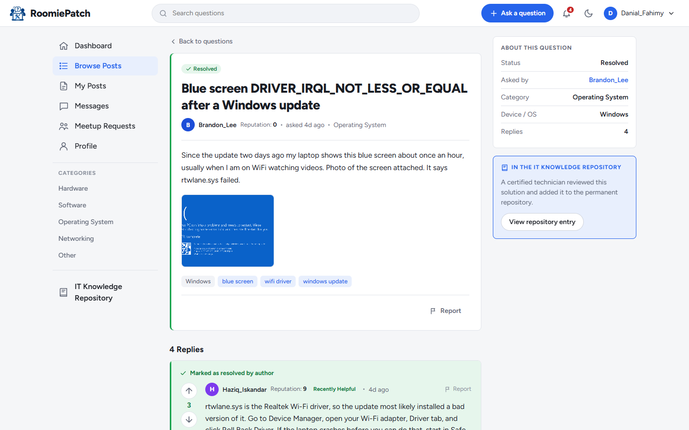
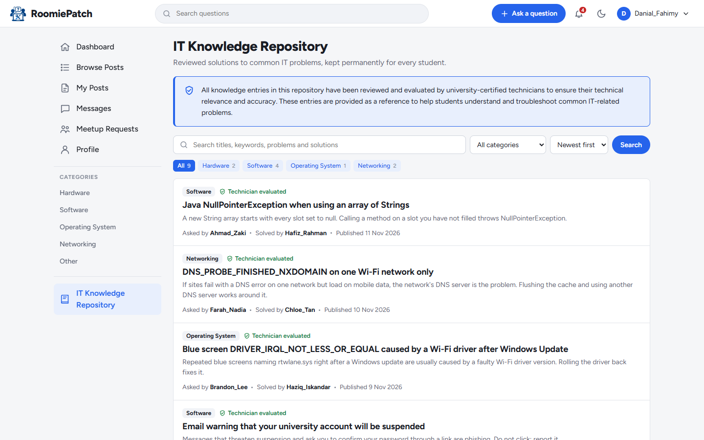
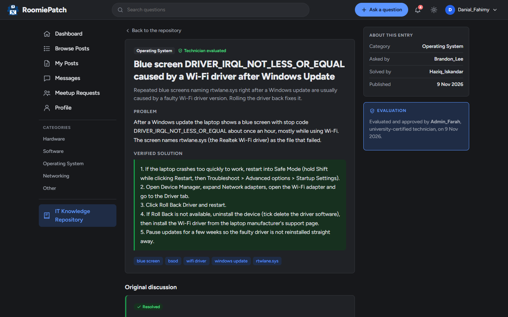
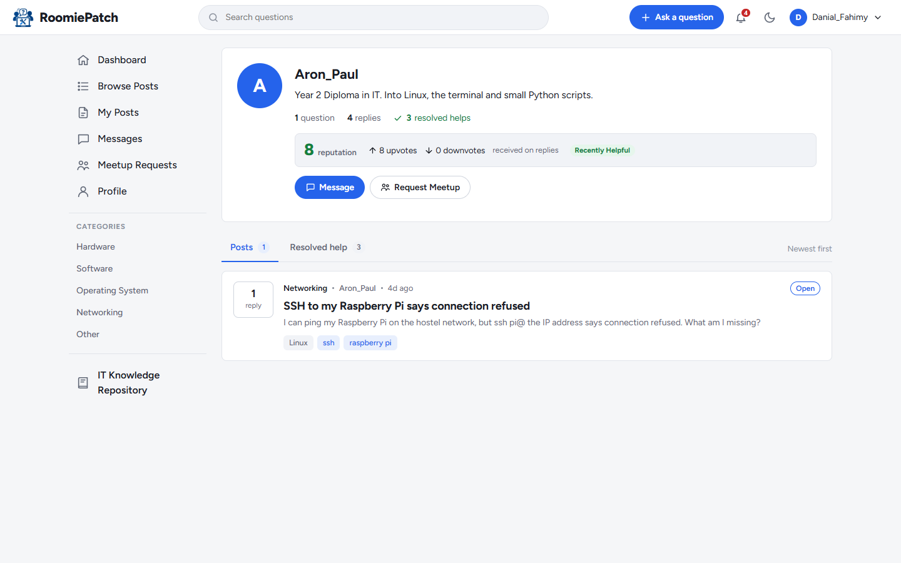
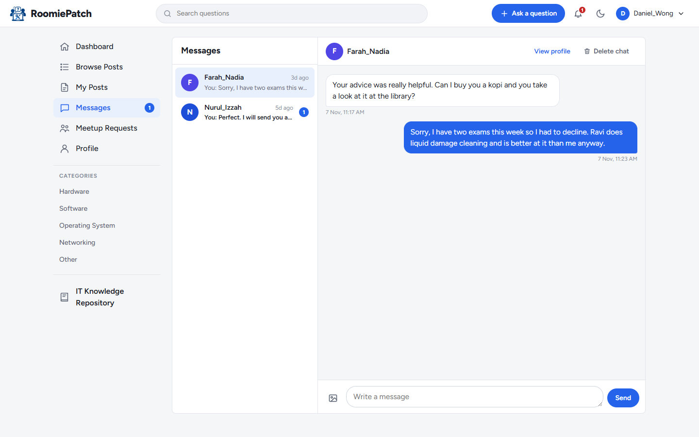
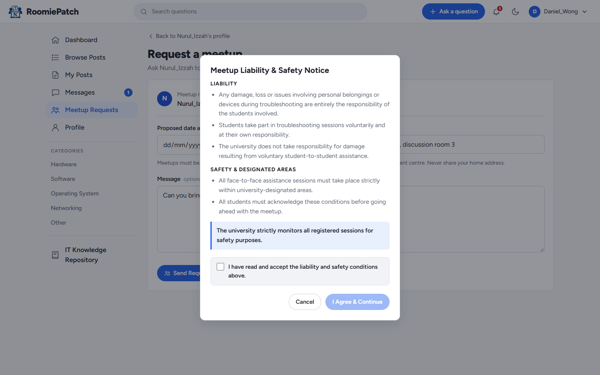
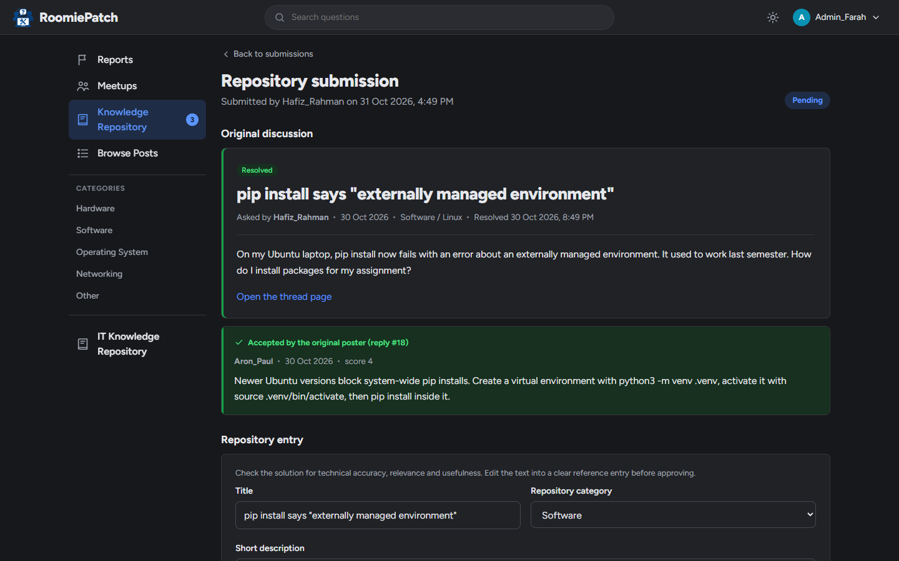

<p align="center">
  
</p>

<h1 align="center">RoomiePatch</h1>

<p align="center">
  A peer-to-peer IT troubleshooting platform where university students help each other fix their own devices.
</p>

---

## About

Most IT support today depends on remote tools and remote management. These tools are usually
made for companies, and they often need special hardware or software. University students
usually use their own laptops and phones, so these tools do not help them much. Some problems,
especially hardware problems, are also hard to fix without seeing the device.

RoomiePatch gives students a place to ask about IT problems and get help from other students.
They can talk about the problem online first, and meet in person on campus if they need more help.

RoomiePatch does not replace the university IT department. It is an extra space where students
can learn from and support each other.

## Features

- **Questions and answers**: post a problem with screenshots and get replies from other students.
- **Resolved posts**: the person who asked the question accepts the reply that solved it. After
  that the discussion is closed.
- **Reputation**: students vote replies up or down, and helpful students build a reputation.
- **IT Knowledge Repository**: good solutions are checked by a certified university technician
  and kept in a library that anyone can search.
- **Direct messages**: students can chat privately and send images.
- **Campus meetups**: students can ask to meet in person. A safety notice must be accepted first.
- **Notifications and live updates**: new replies, messages and meetup changes appear without
  reloading the page.
- **Moderation**: staff review reports and can remove posts or replies that break the rules.
- **Light and dark theme**, and it works on mobile.

## Screenshots

<table>
  <tr>
    <td width="50%"><br><sub>Browse open and resolved questions</sub></td>
    <td width="50%"><br><sub>A resolved post with the accepted reply</sub></td>
  </tr>
  <tr>
    <td><br><sub>IT Knowledge Repository with search and categories</sub></td>
    <td><br><sub>A verified solution (dark theme)</sub></td>
  </tr>
  <tr>
    <td><br><sub>Student profile and reputation</sub></td>
    <td><br><sub>Direct messages</sub></td>
  </tr>
  <tr>
    <td><br><sub>Safety notice before a campus meetup</sub></td>
    <td><br><sub>A technician reviews a submission (dark theme)</sub></td>
  </tr>
</table>

## Folder structure

```
RoomiePatch/
├── actions/        Form handlers that save data, then go back to the page
├── admin/          Staff pages: reports, meetups, knowledge repository review
├── api/            JSON endpoints for live updates
├── assets/
│   ├── css/        style.css
│   ├── fonts/      Figtree font
│   ├── img/        Logo
│   └── js/         main.js, live.js
├── config/         Database connection (db.php)
├── database/       roomiepatch.sql and migrations
├── docs/           Screenshots for this README
├── includes/       Shared parts: login check, header, sidebar, icons, helpers
├── student/        Student pages: browse, posts, messages, meetups, repository
├── uploads/        Images uploaded by users
├── index.php
├── login.php
└── logout.php
```

## Cloud Deployment

Production URL: https://roomiepatch.my

- Cloud Hosting: Microsoft Azure Virtual Machine
- Operating System: Ubuntu Server 24.04 LTS
- Web Server: Nginx
- Backend: PHP 8.3 with PHP-FPM
- Database: MySQL Community Server
- SSL/TLS: Let's Encrypt (Certbot)

## License

Code is under the MIT License (see `LICENSE`). The Figtree font is under the SIL Open Font License.
